# Diffusion stain

NCSNv2 stain translation is the main experiment. The model is a score-based network (NCSNv2) trained on histology patches, then used to sample PAS→H&E and Masson→H&E translations.

## Results

Each GIF plays the 25 sampling steps and holds the final frame. Still images above each GIF are the real input patches.

### PAS → H&E

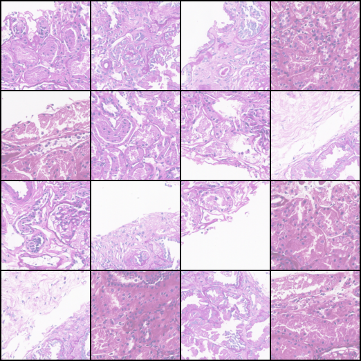

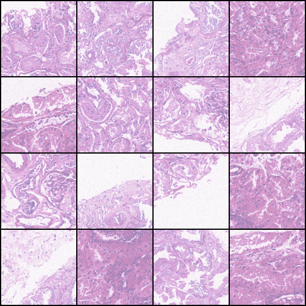

### Masson → H&E

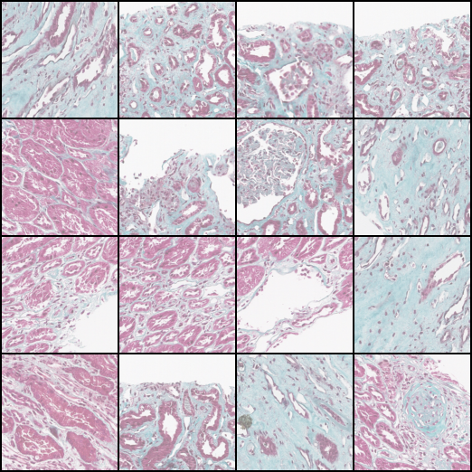

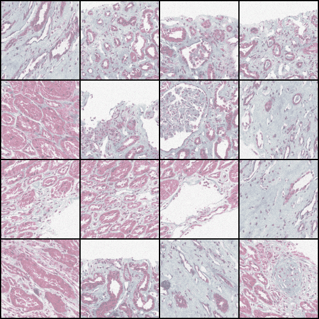

### 128px sampling

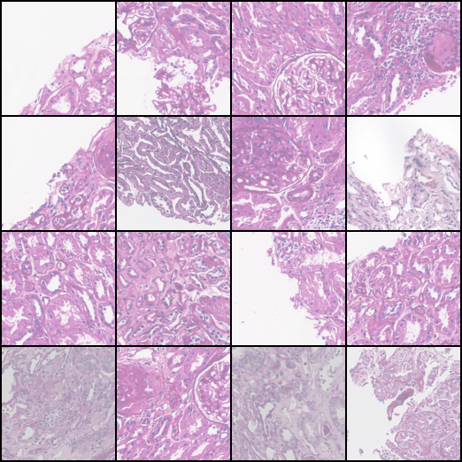

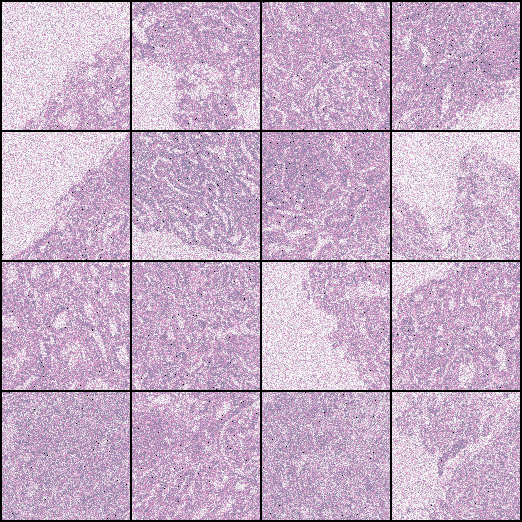

### Other runs

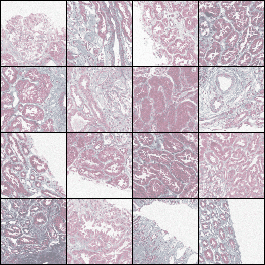

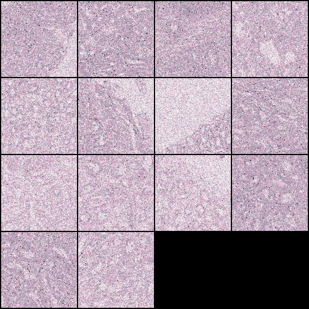


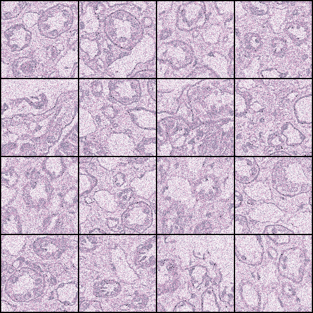

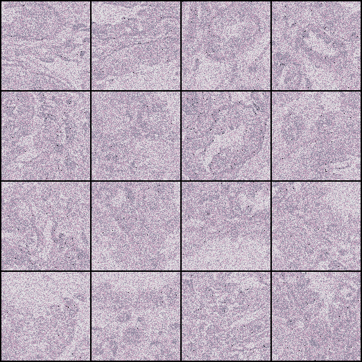

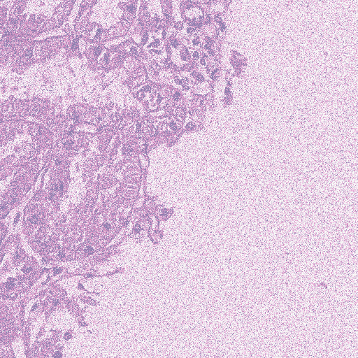

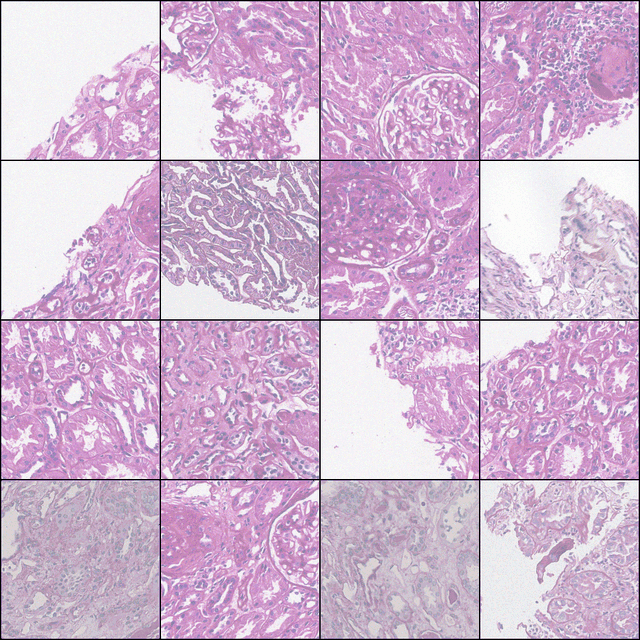

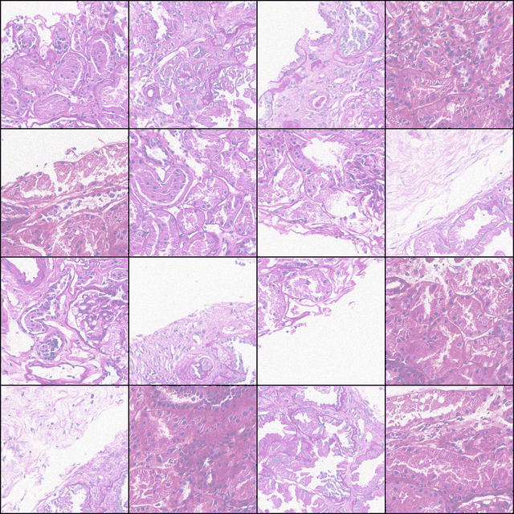

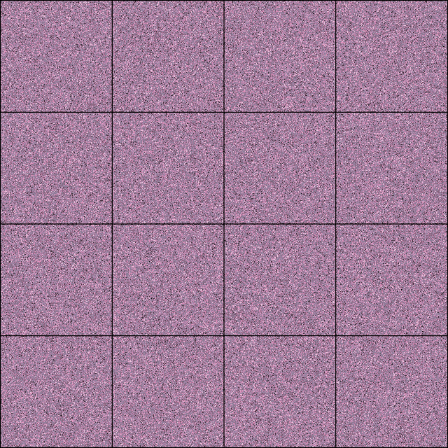

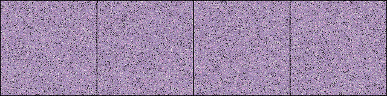

Frame folders are in [`ncsnv2/exp/image_samples/`](ncsnv2/exp/image_samples). Training grids are in [`ncsnv2/exp/logs/`](ncsnv2/exp/logs).

## Code

`ncsnv2/` is a working copy of [yang-song/ncsnv2](https://github.com/ermongroup/ncsnv2) plus the stain experiments:

- `configs/stain.yml`, `configs/stain_sample.yml` — stain training and sampling
- `datasets/stain.py` — stain dataset
- `stain.py`, `cut_svs.py`, `demo.py`, `cmd.txt` — sampling and slide-cutting helpers
- `Real-ESRGAN-master/` — super-resolution helper (weights not included)

Sampling command from `cmd.txt`:

```bash
python main.py --doc stain_sigma_1 --config stain_sample.yml --sample
```

Paths inside the configs still point at the original machine.

## Also in this repo

An earlier HEMIT VAE experiment: code in `Pix2pix_DualBranch/VAE/` and a preview in [`preview/test_reconstructions.png`](preview/test_reconstructions.png). Latent-diffusion sources are in `My_latent_diffusion/`.
